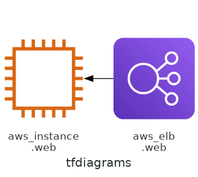

# tfdiagrams

Generate Diagram from terraform output.



## Usage (CLI):

```bash
tfdot [ flags ] [ input file path ]
# terraform graph | tfdot -ograph.png
```

If no input files are supplied, the program reads from **stdin**.

### Install packages

```bash
$ pip install tfdiagrams
```

### Flags

**-T***format*  
Set output language to one of the supported formats. By default, png image is produced.

**-o***outfile*  
Write output to file outfile.

**-e***keyword,comma,separated*  
Exclude keywords separated by commas

## Usage (docker):
```bash
docker run --rm -it \
  --workdir=/app \
  -v "$PWD:/app" \
  semnil/tfdiagrams sh -c "terraform init && terraform graph | tfdot -ograph.png"
```

## Release

1. Open a pull request whose only change is the version and merge it. The version is `version` in `pyproject.toml` and the `TFDIAGRAMS_VERSION` default in `Dockerfile`.
2. When CI passes on master, `tag-release.yml` tags the merged commit with the version (for example `0.5.3`) and creates a draft GitHub Release with generated notes.
3. Edit the notes if needed and publish the draft. Publishing starts `release.yml`, which checks that the tag is the version in `pyproject.toml`, uploads the package to PyPI and then pushes the Docker images to Docker Hub and GHCR.

If CI fails on the merged version bump, re-run it: `tag-release.yml` runs again when it passes. The Release is public before the packages are; if `release.yml` fails, re-run its failed jobs. A tag pushed by hand starts nothing.
